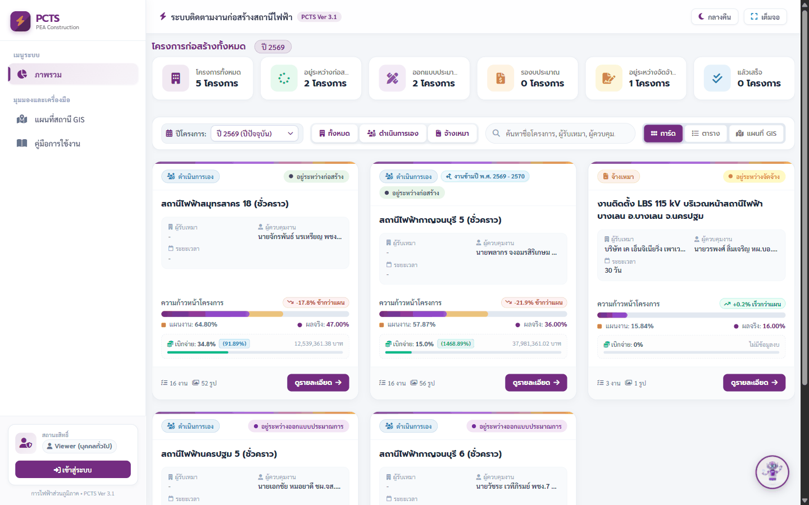
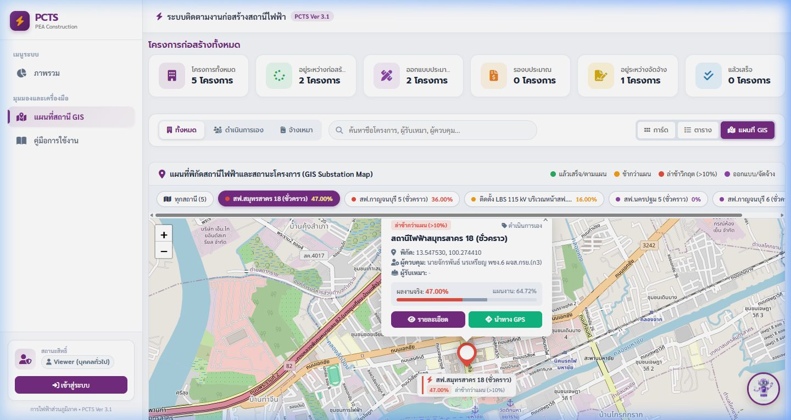
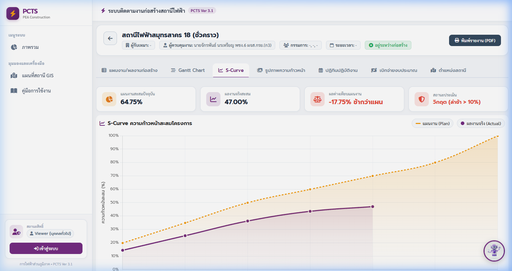
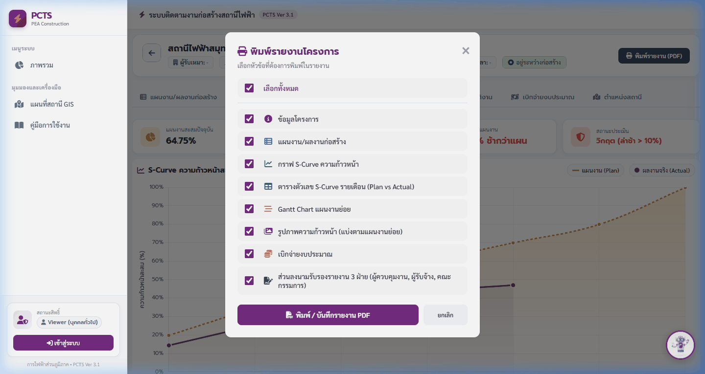
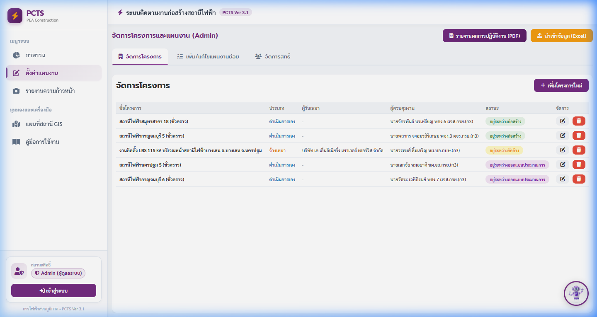
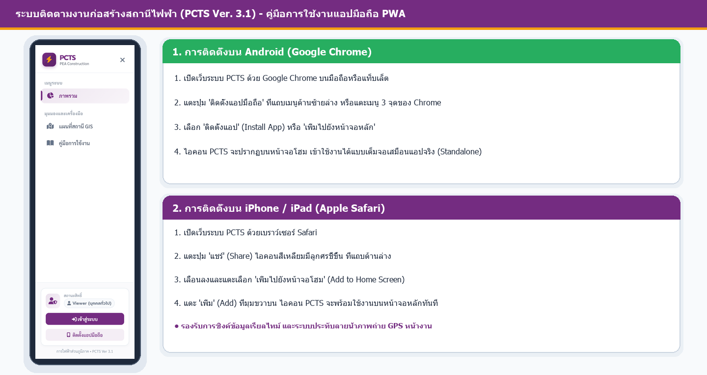

# คู่มือการใช้งานระบบติดตามงานก่อสร้างสถานีไฟฟ้าและสายส่ง
## PEA Construction Tracking System (PCTS VER 4.0 & PSCTM)
**การไฟฟ้าส่วนภูมิภาค (PEA) • สายงานระบบส่งและจำหน่าย**

---

## สารบัญ
1. [ภาพรวมระบบและสถาปัตยกรรม (System Overview & Architecture)](#1-ภาพรวมระบบและสถาปัตยกรรม)
2. [ระดับสิทธิ์และความปลอดภัยในการเข้าใช้งาน (User Roles & Security)](#2-ระดับสิทธิ์และความปลอดภัย)
3. [แดชบอร์ดติดตามงานสายส่งและสถานีไฟฟ้า (PSCTM Dashboard)](#3-แดชบอร์ดติดตามงานสายส่งและสถานีไฟฟ้า-psctm)
4. [แดชบอร์ดภาพรวมโครงการและแผนที่พิกัดสถานี GIS (Project Status Dashboard & GIS Map)](#4-แดชบอร์ดภาพรวมโครงการและแผนที่พิกัดสถานี-gis)
5. [ระบบตัวกรองปี พ.ศ. และโหมดแสดงผล (Year Filter 2569+ & Display Modes)](#5-ระบบตัวกรองปี-พศ-และโหมดแสดงผล)
6. [การติดตามความก้าวหน้าโครงการรายสถานีและสายส่ง 115 kV (Detailed Project Tracking: 12 Modules)](#6-การติดตามความก้าวหน้าโครงการรายสถานีและสายส่ง-115-kv)
7. [การรายงานความก้าวหน้า ภาพถ่ายลายน้ำ GPS และลายเซ็นดิจิทัล 3 ฝ่าย (Daily Reports & Signatures)](#7-การรายงานความก้าวหน้า-ภาพถ่ายลายน้ำ-gps-และลายเซ็นดิจิทัล)
8. [การบริหารจัดการโครงการสำหรับผู้ดูแลระบบ (Admin Management & Approvals)](#8-การบริหารจัดการโครงการสำหรับผู้ดูแลระบบ)
9. [การติดตั้งและใช้งานเป็นแอปพลิเคชันมือถือ (PWA Mobile Application)](#9-การติดตั้งและใช้งานเป็นแอปพลิเคชันมือถือ)
10. [คำถามที่พบบ่อยและการแก้ไขปัญหาเบื้องต้น (FAQ & Troubleshooting)](#10-คำถามที่พบบ่อยและการแก้ไขปัญหาเบื้องต้น)

---

## 1. ภาพรวมระบบและสถาปัตยกรรม

ระบบ **PCTS (PEA Construction Tracking System)** เวอร์ชัน 4.0 (PCTS VER 4.0) บูรณาการร่วมกับระบบแดชบอร์ด **PSCTM (กองติดตามและบริหารโครงการสายส่งและสถานีไฟฟ้า)** พัฒนาขึ้นเพื่อเป็นแพลตฟอร์มศูนย์กลางในการบริหาร ติดตาม ควบคุม และวิเคราะห์งานก่อสร้างสถานีไฟฟ้าและสายส่งของการไฟฟ้าส่วนภูมิภาคทั่วประเทศแบบเรียลไทม์

### จุดเด่นและเทคโนโลยีสำคัญของระบบ:
- **Dual-Dashboard Architecture:** รองรับทั้งแดชบอร์ดติดตามโครงการสายส่งและสถานีไฟฟ้า (PSCTM) และแดชบอร์ดสถานะงานก่อสร้างรายโครงการ (PCTS) เชื่อมโยงข้อมูลสองทางอย่างไร้รอยต่อ
- **Year Filtering from 2569 Onwards:** ระบบกรองข้อมูลปี พ.ศ. เริ่มต้นตั้งแต่ **ปี 2569 เป็นต้นไป** สอดรับกับกรอบแผนงานปัจจุบัน พร้อมรองรับโครงการต่อเนื่องข้ามปีจนกว่าจะแล้วเสร็จ
- **Day & Night Mode (Dark Theme):** รองรับการสลับโหมดการแสดงผลสว่างและมืด เพื่อถนอมสายตาขณะปฏิบัติงานภาคสนามเวลากลางคืนหรือสภาพแสงน้อย
- **Full Screen Presentation:** ปุ่มแสดงผลเต็มจอภาพ รองรับการประชุมมอนิเตอร์และศูนย์ควบคุมการก่อสร้าง
- **GIS Substation Map & GPS Navigation:** แผนที่พิกัดสถานีไฟฟ้าพร้อมป้ายชื่อสถานะถาวร (Permanent Tooltip) และปุ่มเชื่อมต่อไปยัง Google Maps เพื่อนำทางทันที
- **GPS Anti-Tamper Watermark:** กล้องถ่ายภาพพร้อมประทับลายน้ำ กฟภ., วันที่, เวลา และพิกัดละติจูด-ลองจิจูดอัตโนมัติบนภาพถ่าย
- **3-Party Digital Signatures:** กล่องลงนามอิเล็กทรอนิกส์ 3 ฝ่าย (ผู้ควบคุมงาน กฟภ., ผู้รับจ้าง, ประธานกรรมการตรวจรับพัสดุ) บนหน้าจอสัมผัส
- **Financial & Physical S-Curve:** วิเคราะห์เปรียบเทียบผลงานก่อสร้าง (WBS Weight %) และการเบิกจ่ายงบประมาณจริง (รหัส 092) พร้อมปุ่มดาวน์โหลดกราฟความละเอียดสูง 2400x1450 px
- **Live Weather Station & Engineering Advisory:** เชื่อมโยงสภาพอากาศหน้างานสดและคำแนะนำทางวิศวกรรมสำหรับงานก่อสร้างสถานีไฟฟ้า
- **Progressive Web App (PWA):** ติดตั้งลงบนสมาร์ตโฟนและแท็บเล็ตได้ทันที พร้อมระบบแคชข้อมูลสำหรับการใช้งานนอกสถานที่

*รูปที่ 1: ภาพรวมหน้าต่างระบบ PCTS VER 4.0, แถบเมนูด้านข้าง (Sidebar), และส่วนควบคุมธีม*

---

## 2. ระดับสิทธิ์และความปลอดภัย

ระบบ PCTS กำหนดโครงสร้างความปลอดภัยและการเข้าถึงข้อมูลออกเป็น 3 ระดับสิทธิ์ (Multi-tier Role-Based Access Control):

| สิทธิ์ (Role) | กลุ่มผู้ใช้งาน | ขอบเขตการทำงานที่ได้รับอนุญาต |
| :--- | :--- | :--- |
| **Viewer** *(บุคคลทั่วไป/ผู้บริหาร)* | ประชาชน, ผู้บริหาร, ช่างสำรวจ, ผู้สังเกตการณ์ | • เข้าชมแดชบอร์ด PSCTM และสถานะโครงการทั้งหมด • สลับมุมมองการ์ด (Cards), ตาราง (Table), และแผนที่ GIS • ดู WBS, Gantt Chart, S-Curve, คลังรูปภาพ, สภาพอากาศ, ปฏิทิน • ดูและพิมพ์คู่มือการใช้งานขนาด A4 / ส่งออก PDF |
| **Editor** *(ผู้ควบคุมงาน)* | วิศวกรผู้ควบคุมงาน กฟภ., ผู้ช่วยช่าง, หัวหน้าชุดงาน | • ได้รับสิทธิ์ทั้งหมดของ Viewer • เข้าใช้งานเมนู **"รายงานความก้าวหน้า"** • บันทึกอัปเดต % ผลงานจริงสะสมรายกิจกรรม WBS • ถ่ายภาพหน้างานพร้อมประทับลายน้ำพิกัด GPS อัตโนมัติ • จัดทำเอกสารรายงานผลการปฏิบัติงาน PDF และลงนามดิจิทัล 3 ฝ่าย |
| **Admin** *(ผู้ดูแลระบบ)* | หัวหน้าแผนกก่อสร้าง, วิศวกรโครงการ, System Admin | • ได้รับสิทธิ์ทั้งหมดของ Editor • เข้าใช้งานเมนู **"จัดการโครงการ"** และ **"เพิ่ม/แก้ไขแผนงานย่อย"** • สร้าง แก้ไข และลบโครงการสถานีไฟฟ้าและสายส่ง • กำหนดและปรับปรุงค่าน้ำหนักงาน (Weight %) ให้รวมกันได้ 100% • นำเข้าไฟล์ Excel แผนงานและเบิกจ่ายงบประมาณ (รหัส 092) • เข้าใช้งานเมนู **"จัดการสิทธิ์"** เพื่อตรวจสอบและอนุมัติผู้ใช้งานใหม่ |

### ขั้นตอนการเข้าสู่ระบบและขออนุมัติสิทธิ์:
1. แตะหรือคลิกปุ่ม **"เข้าสู่ระบบ"** ที่มุมล่างของแถบเมนูด้านข้าง
2. หากยังไม่มีบัญชี ให้เลือกแท็บ **"ลงทะเบียน"** กรอกอีเมลและรหัสผ่านที่ต้องการ
3. เมื่อลงทะเบียนเสร็จสิ้น บัญชีจะได้รับสถานะเริ่มต้นเป็น `Pending (รออนุมัติ)`
4. ติดต่อผู้ดูแลระบบ (Admin) เพื่อให้อนุมัติปรับสถานะเป็น `Editor` หรือ `Admin` ผ่านเมนู **"จัดการสิทธิ์"**

---

## 3. แดชบอร์ดติดตามงานสายส่งและสถานีไฟฟ้า (PSCTM Dashboard)

แดชบอร์ด **PSCTM (กองติดตามและบริหารโครงการสายส่งและสถานีไฟฟ้า)** เป็นระบบรายงานระดับผู้บริหารและวิศวกรโครงการ สามารถเข้าถึงได้ผ่านเมนู **"ติดตามงานสายส่งและสถานี"** ที่แถบเมนูด้านข้าง

### 3.1 โครงสร้างแท็บหลัก 4 ด้าน:
1. **ภาพรวม (Overview Tab):**
   - **การ์ดสรุป KPI หลัก:** แสดงสถิติจำนวนสายส่งทั้งหมด, ระยะทางรวม (วงจร-กม.), ความก้าวหน้าเฉลี่ยรวม, จำนวนสถานีไฟฟ้าในแผน, และสถานะใบอนุญาต
   - **กราฟแท่งเปรียบเทียบความก้าวหน้า:** วิเคราะห์ % ผลงานสายส่งรายสายส่งแบบภาพรวม
   - **Donut Chart สถานะโครงการ:** จำแนกสัดส่วนโครงการตามสถานะ (แล้วเสร็จ, อยู่ระหว่างก่อสร้าง, รองบประมาณ ฯลฯ)
   - **กราฟสรุปวงเงินงบประมาณ:** เปรียบเทียบแผนงบประมาณกับยอดเบิกจ่ายสะสมจริง
2. **สายส่ง (Transmission Lines Tab):**
   - เจาะลึกข้อมูลระบบสายส่ง 115 kV และสายส่งระดับแรงดันต่างๆ
   - ตารางรายการสายส่ง: ระบุชื่อสายส่ง, ระยะทาง (วงจร-กม.), ความก้าวหน้าสะสม (%), และหมายเหตุสัญญา
   - กราฟเส้นความก้าวหน้ารายเดือน (Monthly Progress Chart): แสดงแนวโน้มผลงานรายเดือนของปี พ.ศ. ที่เลือก
   - กราฟแท่งระยะทางสะสม (Km Progress Bar)
3. **สถานีไฟฟ้า (Substations Tab):**
   - ตารางแสดงรายการสถานีไฟฟ้า พร้อมเลขที่สัญญา และสถานะดำเนินงาน
   - กราฟแท่งจำแนกตามแผนงาน (Programs): เปรียบเทียบผลงานตามหมวดหมู่แผนงาน เช่น แผนงาน PEA-115, แผนงานปรับปรุงสถานีไฟฟ้า (PEA-SS)
   - แถบความก้าวหน้าสถานีไฟฟ้ารายสัญญา (Active Progress Bars)
4. **ใบอนุญาต (Permits & Approvals Tab):**
   - ติดตามกระบวนการขออนุญาตใช้พื้นที่และเข้าทำประโยชน์กับหน่วยงานภายนอก
   - จำแนกตามหน่วยงาน: กรมทางหลวง (ทล.), กรมทางหลวงชนบท (ทช.), กรมป่าไม้, สำนักงานการปฏิรูปที่ดินเพื่อเกษตรกรรม (ส.ป.ก.), การรถไฟแห่งประเทศไทย (รฟท.), และเทศบาล/อบต.
   - **ปุ่มตัวกรองสถานะใบอนุญาต:** เลือกดู `ทั้งหมด`, `รออนุมัติ (Pending)`, หรือ `อนุมัติแล้ว (Approved)`
   - ตารางรายการใบอนุญาตระบุเลขที่หนังสือ วันที่ยื่น และสถานะความคืบหน้า

---

## 4. แดชบอร์ดภาพรวมโครงการและแผนที่พิกัดสถานี GIS

### 4.1 การ์ดสถิติสรุปภาพรวม (KPI Cards)
ส่วนบนสุดของหน้าแดชบอร์ดโครงการสรุปสถานะสถานีไฟฟ้าออกเป็น 6 กลุ่มสี:
- **โครงการทั้งหมด (สีม่วง PEA):** จำนวนโครงการทั้งหมดในระบบตามปีที่เลือก
- **อยู่ระหว่างก่อสร้าง (สีเขียว):** โครงการที่มีสัญญาจ้างและอยู่ระหว่างดำเนินการก่อสร้าง
- **อยู่ระหว่างออกแบบประมาณการ (สีน้ำเงิน):** งานที่อยู่ในขั้นตอนการสำรวจและจัดทำแบบวิศวกรรม
- **รองบประมาณ (สีส้ม):** งานที่รอการจัดสรรและอนุมัติงบประมาณ
- **อยู่ระหว่างจัดจ้าง (สีเหลือง):** อยู่ในกระบวนการประกวดราคาและจัดซื้อจัดจ้าง
- **แล้วเสร็จ (สีฟ้า):** โครงการที่ส่งมอบงานตรวจรับ 100% เรียบร้อยแล้ว

### 4.2 สวิตช์สลับมุมมอง 3 รูปแบบ (View Switcher)
- **การ์ด (Cards View):** นำเสนอในรูปแบบการ์ดแบบไดนามิก แสดงชื่อผู้รับจ้าง วิศวกรผู้ควบคุมงาน หลอดความก้าวหน้างานจริงเทียบแผน และ % ยอดเบิกจ่าย
- **ตาราง (Table View):** แสดงผลตารางเปรียบเทียบข้อมูลสรุป ช่วยให้ดูข้อมูลปริมาณมากได้สะดวก
- **แผนที่สถานี GIS (GIS Map View):** แสดงหมุดสถานีไฟฟ้าทุกแห่งบนแผนที่ดาวเทียมและ OpenStreetMap

### 4.3 ฟังก์ชันเด่นบนแผนที่ GIS (GIS Map Features)
- **Permanent Tooltip Labels:** หมุดแต่ละสถานีมีป้ายชื่อสถานี (เช่น `⚡ สฟ.บางพลี 4`) พร้อมระบุตัวเลข % ผลงานจริง และแถบสีสถานะลอยอยู่ตลอดเวลาโดยไม่ต้องคลิก
- **Substation Quick-Jump Chips Bar:** แถบชิปรายชื่อสถานีด้านบนแผนที่ คลิกชื่อสถานีเพื่อบิน (Fly-to) พุ่งเข้าสู่พิกัดสถานีนั้นพร้อมเปิดหน้าต่างสรุปข้อมูล
- **ปุ่มนำทาง GPS สด:** ในป๊อปอัปสถานีไฟฟ้า มีปุ่มสีเขียว `นำทาง GPS` คลิกเพื่อเปิดแอปพลิเคชัน Google Maps นำทางวิศวกรไปยังหน้างานได้ทันที

*รูปที่ 2: แผนที่พิกัดสถานี GIS พร้อมป้ายแสดงสถานะ ผลงานจริง และหน้าต่างนำทาง GPS*

---

## 5. ระบบตัวกรองปี พ.ศ. และโหมดแสดงผล

### 5.1 ตัวกรองปี พ.ศ. เริ่มต้นปี 2569 เป็นต้นไป (Year Filter 2569+)
เพื่อให้การติดตามงานสอดคล้องกับกรอบระยะเวลาแผนงานและข้อมูลปัจจุบัน ระบบ PCTS VER 4.0 ได้กำหนดมาตรฐานการกรองปี พ.ศ. ดังนี้:
- **เริ่มต้นที่ปี 2569:** ตัวเลือกในระบบจะแสดงเฉพาะ **ปี 2569 (ปีปัจจุบัน)** และปีถัดไป (เช่น 2570) โดยตัดปีก่อนหน้า 2569 (เช่น 2568, 2567) ออกทั้งหมด
- **ตัวเลือก "ทุกปีโครงการ (ตั้งแต่ปี 2569)":** เมื่อเลือกดูภาพรวมทั้งหมด ระบบจะกรองเฉพาะโครงการที่มีกิจกรรมดำเนินงานตั้งแต่ปี 2569 เป็นต้นไป
- **เงื่อนไขโครงการต่อเนื่อง (Multi-Year & Incomplete Projects):**
  - โครงการที่มีสัญญาข้ามปีจะแสดงผลในทุกปีที่โครงการมีแผนงาน
  - **โครงการที่ยังไม่แล้วเสร็จ:** จะแสดงผลต่อเนื่องในแดชบอร์ดปีปัจจุบันไปจนกว่างานจะส่งมอบแล้วเสร็จ 100% ("หรือจนกว่างานจะแล้วเสร็จ")
- **ระบบ Two-Way Synchronization:** เมื่อเปลี่ยนปี พ.ศ. ในแดชบอร์ดสถานะโครงการ หรือในแดชบอร์ด PSCTM ระบบจะปรับปรุงตัวกรองของทั้งสองหน้าให้ตรงกันโดยอัตโนมัติ

### 5.2 โหมดกลางวัน / กลางคืน (Day & Night Mode)
- **ปุ่มสลับธีม (Theme Toggle):** บริเวณ Top Header Bar มุมขวาบน (ไอคอนรูปพระจันทร์ / พระอาทิตย์)
- **โหมดกลางวัน (Light Mode):** โทนสีขาวสว่าง สะอาดตา เหมาะสำหรับการใช้งานในห้องทำงาน
- **โหมดกลางคืน (Dark Mode):** โทนสีกรมท่าเข้มและเทาเข้ม ออกแบบตามมาตรฐาน Contrast Ratio ช่วยถนอมสายตาขณะปฏิบัติงานยามค่ำคืนหรือในสภาพแสงน้อยหน้างาน
- รองรับการปรับธีมครอบคลุมทุกองค์ประกอบ: การ์ด, ตาราง, ปฏิทิน, กราฟ Chart.js, แผนที่ GIS, และโมดอลรายงาน

### 5.3 โหมดดูข้อมูลเต็มจอ (Full Screen Mode)
- คลิกปุ่ม **"เต็มจอ"** ที่ Top Header Bar เพื่อขยายหน้าต่างเว็บเต็มจอภาพ เหมาะสำหรับการเปิดบน Smart TV ในห้องประชุมหรือศูนย์ติดตามสถานการณ์

---

## 6. การติดตามความก้าวหน้าโครงการรายสถานีและสายส่ง 115 kV

เมื่อคลิกปุ่ม **"ดูรายละเอียด"** บนการ์ดโครงการ จะเข้าสู่หน้าจอติดตามเจาะลึก **12 โมดูลสำคัญ** ครอบคลุมทั้งงานก่อสร้างสถานีไฟฟ้าและระบบสายส่ง 115 kV พร้อมการออกแบบส่วนหัวโครงการใหม่ล่าสุด (Modern Project Header):

### 6.0 ส่วนหัวโครงการและแถบระยะเวลาสัญญา (Project Header & Countdown Ribbon)
ส่วนหัวของโครงการได้รับการจัดระเบียบให้ผู้บริหารและวิศวกรประเมินสถานะโครงการได้ในทันที:
- **Top-Bar:** แสดงชื่อสถานีไฟฟ้า/โครงการ, รหัส WBS, แถบสถานะการก่อสร้าง (เช่น อยู่ระหว่างก่อสร้าง, สถานีไฟฟ้าชั่วคราว), รูปแบบการดำเนินงาน (จ้างเหมา / ดำเนินการเอง), ปุ่มพิมพ์รายงานทางการ (PDF) และปุ่มดาวน์โหลดภาพถ่ายทั้งหมด (ZIP)
- **กล่องข้อมูล 4 มิติหลัก (4-Column Meta Grid):**
  1. 👤 **ผู้ควบคุมงาน:** ระบุชื่อ-นามสกุล และตำแหน่งวิศวกรผู้ควบคุมงาน กฟภ.
  2. 🏢 **ผู้รับเหมา:** ระบุชื่อบริษัทคู่สัญญา หรือหน่วยงาน กฟภ. ที่เข้าดำเนินการ
  3. 👥 **คณะกรรมการตรวจรับพัสดุ:** รายชื่อคณะกรรมการตรวจรับพัสดุครบทั้ง 3 ท่าน
  4. 📅 **ระยะเวลาดำเนินงาน:** วันเริ่มต้นและวันสิ้นสุดสัญญาตามระเบียบพัสดุ
- **แถบริบบิ้นนับถอยหลังสัญญา (Contract Countdown Ribbon):** แถบสีเขียว/ส้ม/แดง คำนวณวันคงเหลือตามสัญญาหรือจำนวนวันล่วงเลยกำหนดแบบอัตโนมัติทุกวัน พร้อมปุ่มลัด **"EOT & ค่าปรับ"** เข้าสู่ระบบจำลองการขยายเวลาสัญญา

---

### รายการ 12 โมดูลย่อยในหน้ารายละเอียดโครงการ:

1. **แผนงาน/ผลงานก่อสร้าง (WBS Module):**
   - ตารางแจกแจงทุกกิจกรรม วันเริ่มต้น วันสิ้นสุด และค่าน้ำหนักงาน (Weight %)
   - แสดง % ผลงานจริงสะสม และประเมินสถานะล่าช้า/เร็วกว่าแผน
2. **Gantt Chart:**
   - แผนภูมิแท่งแสดงไทม์ไลน์ของแต่ละกิจกรรม WBS สลับมุมมองระดับ **วัน / สัปดาห์ / เดือน** ได้อิสระ
3. **S-Curve & High-Definition Export:**
   - กราฟเปรียบเทียบผลงานสะสมจริง (Actual) เทียบกับเส้นแผนงาน (Plan)
   - แถบริบบิ้นประเมินสถานะอัตโนมัติ: `ปกติ`, `ช้ากว่าแผน`, หรือ `ล่าช้าวิกฤต`
   - **ปุ่มส่งออกภาพ HD (2400x1450 px):** ดาวน์โหลดภาพกราฟความละเอียดสูงพร้อมหัวกระดาษทางการ กฟภ. หรือคัดลอกลงคลิปบอร์ดสำหรับวางใน PowerPoint
4. **รูปภาพความก้าวหน้า (Photo Gallery):**
   - คลังภาพถ่ายหน้างานจัดหมวดหมู่แยกตามกิจกรรม WBS สามารถคลิกดูภาพขยายความละเอียดสูง
5. **ปฏิทินปฏิบัติงาน (Project Calendar):**
   - ปฏิทินแสดงรอบระยะเวลาการดำเนินงานของแต่ละกิจกรรมในแต่ละเดือน
6. **เบิกจ่ายงบประมาณ (Disbursement Tracking):**
   - เปรียบเทียบแผนเบิกจ่ายรายเดือนกับยอดเบิกจ่ายจริงสะสมตามรหัสพัสดุ 092
7. **ตำแหน่งสถานีและสภาพอากาศสด (Substation Map & Live Weather Station):**
   - แผนที่แสดงพิกัดที่ตั้งสถานีและรัศมี 300 เมตร
   - **วิดเจ็ตพยากรณ์อากาศสด (Live Weather):** ตรวจวัดอุณหภูมิ, ความชื้น, ปริมาณฝน, และความเร็วลม ณ พิกัดสถานีแบบเรียลไทม์ พร้อมคำแนะนำทางวิศวกรรมสำหรับงานก่อสร้าง (เช่น งานเทคอนกรีตฐานราก, งานติดตั้งอุปกรณ์ 115 kV)
8. **รายการตรวจรับข้อบกพร่อง (Punch List / Defect Management):**
   - บันทึกรายการข้อบกพร่องก่อนการตรวจรับส่งมอบงาน พร้อมแนบภาพถ่าย ก่อนแก้ไข (Before) และหลังแก้ไข (After)
   - แยกระดับความเร่งด่วน หมวดหมู่งาน บันทึกผลการแก้ไข และระบบกรรมการตรวจรับอนุมัติปิดรายการ (Close Defect)
9. **เปรียบเทียบภาพ ก่อน-หลัง (Interactive Before & After Slider):**
   - สไลเดอร์ลากเปรียบเทียบภาพถ่ายพื้นที่เดิมก่อนเริ่มงาน กับภาพผลงานการก่อสร้างในปัจจุบัน
10. **ระบบคำนวณค่าปรับสัญญาและสไลเดอร์จำลอง EOT (Contract Penalty & EOT Simulator):**
    - คำนวณค่าปรับตามสัญญา กฟภ. และเกณฑ์วิกฤต 10% ตาม พ.ร.บ. การจัดซื้อจัดจ้างและการบริหารพัสดุภาครัฐ พ.ศ. 2560 มาตรา 103
    - สไลเดอร์จำลองการขยายเวลาสัญญา (+0 ถึง +180 วัน) พร้อมคำนวณค่าปรับที่ประหยัดได้ (Penalty Saved) และวันสิ้นสุดสัญญาใหม่แบบเรียลไทม์
    - ใบสรุปรายงานสัญญาทางการ (Contract Summary Sheet) พร้อมปุ่มคัดลอกข้อความและปุ่มพิมพ์รายงาน
11. **ระบบดาวน์โหลดภาพถ่ายหน้างานเป็น ZIP รายงวด (Batch Photo ZIP Downloader):**
    - ดาวน์โหลดรูปภาพทั้งหมดของโครงการ หรือกรองเฉพาะหมวดงาน WBS, กรองตามงวดเดือน, หรือหมวด Punch List (Before/After)
    - ประทับตราลายน้ำพิกัด GPS อัตโนมัติ (PEA GPS Watermark) ป้องกันการนำภาพเก่ามาส่งมอบงาน
    - สร้างไฟล์สารบัญรูปภาพ `Photo_Manifest.csv` และใบปะหน้าสรุปเพื่อแนบส่งเบิกจ่ายเงินงวด
12. **แดชบอร์ดรายต้นเสาสายส่ง 115 kV (Pole-by-Pole Matrix & ROW Bottlenecks):**
    - แดชบอร์ดติดตามความก้าวหน้า 4 ขั้นตอนมาตรฐาน กฟภ. รายต้นเสา (P01 - P24)
    - Bottleneck Spotlight Banner แจ้งเตือนจุดติดปัญหาคอขวดและกรรมสิทธิ์ที่ดิน (Right of Way / ROW) เช่น ปัญหาสายสื่อสาร Hot-Line, เจรจาชาวบ้าน, หรือแนวท่อใต้ดิน
    - ตาราง Matrix สลับสถานะรวดเร็ว (Cycle Status), ดูพิกัดบนแผนที่ GIS ทันที และส่งออกข้อมูลเป็นไฟล์ Excel (.xlsx)

*รูปที่ 3: หน้าจอติดตามความก้าวหน้าโครงการ กราฟ S-Curve, WBS, และระบบวิเคราะห์ผลงาน*

---

### 6.1 ระบบคำนวณค่าปรับและวันสิ้นสุดสัญญาใหม่ (Contract Penalty & EOT Simulator)
ระบบบริหารสัญญาเพื่อความโปร่งใสและป้องกันข้อพิพาทเรื่องเวลาและค่าปรับ เข้าถึงได้โดยคลิกที่ Badge **"EOT & ค่าปรับ"** หรือ **"EOT +XX วัน"** บริเวณส่วนหัวของหน้ารายละเอียดโครงการ ประกอบด้วย 3 แท็บการทำงาน:
1. **แท็บประวัติการขยายสัญญา (EOT Records):** บันทึกประวัติการขอขยายสัญญาแต่ละครั้ง เลขที่หนังสือ วันที่เริ่มต้น วันที่สิ้นสุด และเหตุผลความจำเป็น
2. **แท็บคำนวณค่าปรับ & จำลอง EOT (Penalty & Simulator):**
   - **การ์ด KPI สรุปสถานะสัญญา:** วงเงินสัญญา, อัตราค่าปรับต่อวัน (เช่น 0.10%), วันสิ้นสุดสัญญาเดิมและใหม่, จำนวนวันล่วงเลยกำหนด, และยอดค่าปรับสะสม
   - **แถบแจ้งเตือนระดับวิกฤต (10% Threshold):** แจ้งเตือนสีแดงทันทีเมื่อยอดค่าปรับสะสมแตะ 10% ของมูลค่าสัญญา ซึ่งเข้าข่ายการพิจารณาบอกเลิกสัญญาตามกฎหมาย
   - **Interactive EOT Slider:** ผู้ควบคุมงานหรือคณะกรรมการสามารถเลื่อนแถบสไลเดอร์เพื่อทดสอบว่า หาก กฟภ. พิจารณาขยายสัญญาให้อีก X วัน จะช่วยลดค่าปรับสะสมได้กี่บาท และวันสิ้นสุดสัญญาจำลองจะเป็นวันที่เท่าใด
3. **แท็บสรุปรายงานสัญญา (Contract Summary Sheet):** เอกสารสรุปสถานะสัญญาในรูปแบบกระดาษทางการ กฟภ. พร้อมปุ่ม **"คัดลอกสรุปสัญญา"** สำหรับวางในบันทึกข้อความราชการ และปุ่ม **"พิมพ์รายงานสรุป"**

---

### 6.2 ระบบดาวน์โหลดภาพถ่ายหน้างานเป็น ZIP รายงวด (Batch Photo ZIP Downloader)
ช่วยให้วิศวกรและผู้ควบคุมงาน กฟภ. สามารถรวบรวมภาพถ่ายหน้างานจริงที่รายงานผ่านระบบ ส่งออกเป็นไฟล์ `.zip` ได้อย่างเป็นหมวดหมู่เพียงคลิกเดียว:
1. **การเปิดใช้งาน:** คลิกปุ่ม **"ดาวน์โหลดภาพ (ZIP)"** ที่ส่วนหัวโครงการ หรือในแท็บ "รูปภาพความก้าวหน้า"
2. **ขอบเขตการดาวน์โหลด (Grouping Scopes):**
   - **ภาพทั้งหมดของโครงการ:** จัดโครงสร้างโฟลเดอร์ตามชื่องาน WBS ย่อย
   - **แยกเฉพาะหมวดงาน WBS:** เลือกดาวน์โหลดเฉพาะงานที่ต้องการส่งมอบ
   - **แยกตามงวดเดือน:** กรองภาพตามเดือนที่ถ่ายจริงเพื่อแนบเบิกเงินงวด
   - **รายการตรวจรับ (Punch List):** แยกโฟลเดอร์ภาพก่อนแก้ไข (`01_Before`) และหลังแก้ไข (`02_After`)
3. **ฟังก์ชันพิเศษ:**
   - **Stamp PEA GPS Watermark:** ประทับพิกัดละติจูด-ลองจิจูด วันที่ เวลา และสังกัด กฟภ. ลงบนทุกรูปภาพใน ZIP อัตโนมัติ
   - **Include Photo_Manifest.csv:** แนบไฟล์ตารางสารบัญรูปภาพพร้อมคำอธิบายและพิกัด เพื่อให้คณะกรรมการตรวจรับตรวจสอบความถูกต้องได้สะดวกรวดเร็ว

---

### 6.3 แดชบอร์ดความคืบหน้ารายต้นเสา สายส่ง 115 kV (Pole-by-Pole Matrix)
เข้าใช้งานผ่านแท็บ **"สายส่ง 115 kV (Pole Matrix)"** ออกแบบเฉพาะสำหรับงานก่อสร้างสายส่งไฟฟ้าแรงสูง 115 kV ทั้งประเภทเสาคอนกรีตอัดแรงและเสาโครงเหล็ก (Steel Lattice Towers) เชื่อมโยงเข้าสถานีไฟฟ้า:
1. **มาตรฐานการระบุหมายเลขต้นเสา (Pole Numbering):**
   - ใช้รหัส **P นำหน้า** ตามด้วยหมายเลข 2 หลัก (เช่น `P01`, `P02`, ..., `P24`) เพื่อให้สอดคล้องกับระเบียบการเรียกต้นเสาสายส่งของการไฟฟ้าส่วนภูมิภาค
   - ระบบมีฟังก์ชันปรับปรุงฐานข้อมูลเก่าที่เคยใช้ตัวอักษร T ให้เป็นตัวอักษร P โดยอัตโนมัติ
2. **KPI Ribbon สรุป 4 ขั้นตอนก่อสร้างมาตรฐาน กฟภ.:**
   - 🏗️ **งานฐานราก (Foundation):** สรุปจำนวนต้นและ % ความคืบหน้า
   - 🗼 **งานประกอบและตั้งเสา (Erection):** สรุปจำนวนต้นที่ตั้งเสาเสร็จสมบูรณ์
   - ⚡ **งานพาดสายนำกระแสและสายกราวด์ (Stringing):** สรุปช่วงเสาที่พาดสายแล้วเสร็จ
   - 🔍 **งานตรวจสอบและทดสอบ (Testing):** สรุปสถานะการทดสอบระบบก่อนจ่ายไฟ
3. **Bottleneck Spotlight Banner (การแจ้งเตือนจุดคอขวดและกรรมสิทธิ์ที่ดิน):**
   - แถบแจ้งเตือนสีแดงเด่นชัดด้านบน เมื่อมีต้นเสาที่ติดปัญหา เช่น ติดแนวท่อประปา/ก๊าซ, เจรจาชาวบ้านเรื่องกรรมสิทธิ์ที่ดิน (ROW), หรือรอตัดตอนสลับวงจร Hot-Line
   - สามารถคลิกที่ชิปหมายเลขเสาเพื่อเปิดหน้าต่างแก้ไขและบันทึกรายละเอียดปัญหาได้ทันที
4. **ตาราง Matrix รายต้นเสา:**
   - แสดงหมายเลขเสา (Pole No.), ประเภทเสา (Terminal / Tension / Suspension / Angle), ช่วงระยะสาย (Span / กม.), พิกัด GPS, และสถานะทั้ง 4 ขั้นตอน
   - **คลิกสลับสถานะรวดเร็ว (Cycle Status):** คลิกที่ป้ายสถานะเพื่อสลับเป็น `ยังไม่เริ่ม` ➔ `กำลังทำ` ➔ `แล้วเสร็จ` ➔ `ติดปัญหา`
   - **ปุ่มเปิดดูพิกัด GIS:** คลิกไอคอนหมุดเพื่อเปิดแผนที่ดาวเทียมดูตำแหน่งต้นเสาหน้างาน
   - **ปุ่มส่งออก Excel (.xlsx):** สร้างไฟล์ Excel สรุปข้อมูลสายส่ง 115 kV ทุกต้น พร้อมหัวตาราง Pole No., Pole Type, และสถานะงานทุกเฟส

---

### 6.4 ระบบบริหารจัดการรายการตรวจรับและข้อบกพร่อง (Punch List & Defect Management)
เข้าใช้งานผ่านแท็บ **"รายการตรวจรับ (Punch List)"** เพื่อให้วิศวกรผู้ควบคุมงาน ผู้รับจ้าง และคณะกรรมการตรวจรับพัสดุ ติดตามและเคลียร์จุดบกพร่องหน้างานได้อย่างเป็นรูปธรรม:
1. **แถบสรุปสถานะข้อบกพร่อง (KPI Badges):**
   - รายการทั้งหมด (Total Defects)
   - รอดำเนินการแก้ไข (Pending Defects)
   - แก้ไขแล้ว (รอตรวจซ้ำ) (Resolved Defects)
   - ตรวจรับเรียบร้อย / ปิดรายการ (Closed Defects)
2. **การเพิ่มรายการข้อบกพร่องใหม่ (Add Punch Item):**
   - คลิกปุ่ม **"+ เพิ่มรายการข้อบกพร่อง"** (เฉพาะผู้ใช้งานสิทธิ์ Editor และ Admin)
   - กรอกข้อมูลสำคัญ:
     - **หัวข้อข้อบกพร่อง / จุดที่ต้องแก้ไข:** เช่น สีตู้สวิตช์บอร์ดถลอก, ทอร์กน็อตสายดินไม่แน่น
     - **ตำแหน่งในสถานีไฟฟ้า:** ระบุพิกัดชัดเจน เช่น ลานหม้อแปลง T1, Bay 115 kV, อาคารควบคุม
     - **หมวดหมู่งาน:** งานโยธาและโครงสร้าง, งานติดตั้งอุปกรณ์ไฟฟ้า 115 kV, งานระบบควบคุมป้องกันและสื่อสาร (CSCS), งานความปลอดภัย (SHE)
     - **ระดับความเร่งด่วน:** ปานกลาง (Normal), เร่งด่วนมาก (Critical), ทั่วไป (Minor)
     - **กำหนดแล้วเสร็จ (Due Date):** กำหนดเส้นตายส่งมอบงานแก้ไข
     - **ผู้รับผิดชอบ:** ระบุชื่อผู้รับจ้าง หรือหัวหน้าชุดช่างผู้รับผิดชอบ
     - **แนบภาพถ่ายหน้างานก่อนแก้ไข (Before Photo):** ถ่ายภาพหรือเลือกไฟล์ ระบบจะแสดงภาพตัวอย่าง (Preview) ขนาดไฟล์ พร้อมประทับตราลายน้ำพิกัด GPS อัตโนมัติ
3. **การส่งมอบงานแก้ไขเสร็จ (Resolve Punch Item):**
   - ผู้รับจ้างหรือผู้ควบคุมงานคลิกปุ่ม **"อัปเดตงานแก้ไขเสร็จ"** บนการ์ดรายการ
   - หน้าต่างจะแสดงภาพถ่ายก่อนแก้ไข (Before Photo) เพื่อให้ดูเปรียบเทียบ
   - พิมพ์ **"บันทึกการดำเนินการแก้ไข" (Resolution Note)** เช่น ได้ทำการขัดสนิมและพ่นสีตู้ใหม่เรียบร้อยแล้ว
   - แนบภาพถ่ายหลังแก้ไขเสร็จสมบูรณ์ (After Photo) พร้อมประทับพิกัด GPS เพื่อยืนยันว่าแก้ไขหน้างานจริง
   - เมื่อบันทึกสำเร็จ สถานะจะเปลี่ยนเป็น **"แก้ไขแล้ว (รอตรวจซ้ำ)"**
4. **การตรวจรับและอนุมัติปิดรายการ (Approval by Committee):**
   - คณะกรรมการตรวจรับพัสดุเข้าตรวจสอบผลงานเปรียบเทียบ ก่อนแก้ไข vs หลังแก้ไข
   - หากผลงานถูกต้องเรียบร้อย ให้คลิกปุ่ม **"อนุมัติผ่าน (Close)"** เพื่อปิดรายการถาวร
   - หากยังมีข้อบกพร่อง สามารถคลิก **"เปิดตรวจซ้ำ (Reopen)"** เพื่อส่งกลับไปแก้ไขใหม่

---

## 7. การรายงานความก้าวหน้า ภาพถ่ายลายน้ำ GPS และลายเซ็นดิจิทัล 3 ฝ่าย

*(สำหรับผู้ใช้งานสิทธิ์ Editor และ Admin)*

### 7.1 ขั้นตอนการรายงานผลงานประจำวัน
1. คลิกเมนู **"รายงานความก้าวหน้า"** บนแถบเมนูด้านข้าง
2. เลือก **โครงการ** และเลือก **แผนงานย่อย (Task)** ที่ต้องการบันทึก
3. ระบุ **วันที่รายงาน** และกรอก **% ผลงานจริงสะสม** ของกิจกรรมนั้น
4. บันทึกรายละเอียดการปฏิบัติงาน ปัญหาอุปสรรคหน้างาน และแนวทางแก้ไข
5. แนบภาพถ่ายหน้างาน (ถ่ายสดผ่านกล้องมือถือหรือเลือกจากคลังภาพ)
6. คลิกปุ่ม **"ส่งรายงาน"** ข้อมูลจะถูกบันทึกและซิงค์ไปยังแดชบอร์ดทันที

### 7.2 ระบบประทับลายน้ำ GPS อัตโนมัติ (Anti-Tamper Watermark Engine v4.0)
เมื่ออัปโหลดรูปภาพผ่านระบบรายงานความก้าวหน้า หรือระบบ Punch List ระบบจะประมวลผลผ่าน **Watermark Engine v4.0** อัตโนมัติ:
- **ข้อมูลที่ประทับบนภาพถ่าย:**
  1. ⚡ **ตราสัญลักษณ์ทางการ PEA:** ป้าย Badge สีม่วง กฟภ. พร้อมขอบสีทองสะท้อนแสง
  2. 🏢 **ชื่อโครงการ/สถานีไฟฟ้า:** ระบุชื่อโครงการและสังกัดอย่างชัดเจน
  3. 🕒 **วันและเวลาทางการไทย:** ระบุ วัน เดือน (ตัวย่อภาษาไทย) ปี พ.ศ. และเวลาถึงระดับวินาที (เช่น `18 ต.ค. 2569 เวลา 10:45:20 น.`)
  4. 📋 **ชื่องานย่อย / รายการข้อบกพร่อง:** ระบุกิจกรรม WBS หรืองาน Punch List ที่เกี่ยวข้อง
  5. 👤 **ชื่อ-นามสกุล และรหัสพนักงาน:** ดึงข้อมูลตัวตนของผู้รายงาน/ผู้ควบคุมงานจากระบบล็อกอิน กฟภ.
  6. 💼 **ตำแหน่ง/หน้าที่:** ระบุตำแหน่งทางราชการของผู้ส่งมอบงาน
  7. 📍 **พิกัด GPS ละติจูด-ลองจิจูด:** พิกัดจริงจากดาวเทียมความละเอียดทศนิยม 6 ตำแหน่ง (เช่น `GPS: 13.547530, 100.274410`)
- **การบีบอัดและปรับขนาดภาพอัตโนมัติ (Smart Image Compression):**
  - ระบบจะย่อขนาดภาพให้มีความกว้างสูงสุดไม่เกิน 900x900 พิกเซล และบีบอัดด้วยคุณภาพ 0.68-0.70
  - ขนาดไฟล์หลังบีบอัดจะอยู่ที่ประมาณ **35-45 KB** เท่านั้น ซึ่งยังคงความคมชัดสูงสำหรับเปิดดูในหน้าจอหรือพิมพ์รายงาน แต่ช่วยประหยัดแบนด์วิดท์หน้างานและป้องกันปัญหาข้อมูลเต็มในระบบฐานข้อมูล 100%

### 7.3 การจัดทำรายงาน PDF และการลงนามดิจิทัล 3 ฝ่าย
1. ในหน้าบันทึกรายงาน หรือหน้ารายละเอียดโครงการ คลิกปุ่ม **"รายงานผลการปฏิบัติงาน (PDF)"**
2. เลือกช่วงวันที่รายงาน และเลือกรูปภาพหน้างานที่ต้องการบรรจุในรายงาน
3. ในส่วน **ลงนามอิเล็กทรอนิกส์ 3 ฝ่าย (Digital Signatures)**:
   - **ฝ่ายที่ 1:** ผู้ควบคุมงาน การไฟฟ้าส่วนภูมิภาค
   - **ฝ่ายที่ 2:** ผู้รับจ้าง / หัวหน้าชุดงานก่อสร้าง
   - **ฝ่ายที่ 3:** ประธานกรรมการตรวจรับพัสดุ
   *(สามารถใช้นิ้วมือหรือปากกา Stylus ลงนามบนหน้าจอสัมผัสได้ทันที)*
4. คลิกปุ่ม **"พิมพ์รายงาน PDF"** เพื่อส่งออกเอกสารรายงานผลงานตามแบบฟอร์มมาตรฐานของการไฟฟ้าส่วนภูมิภาค

*รูปที่ 4: ระบบจัดทำรายงาน PDF พร้อมแนบภาพถ่ายหน้างาน และกล่องลงนามดิจิทัล 3 ฝ่าย*

---

## 8. การบริหารจัดการโครงการสำหรับผู้ดูแลระบบ

*(สำหรับผู้ใช้งานสิทธิ์ Admin)*

### 8.1 การเพิ่มและแก้ไขโครงการ (Project Work Types & Management)
1. คลิกเมนู **"จัดการโครงการ"** ในส่วนผู้ดูแลระบบ หรือคลิกปุ่ม **"แก้ไขโครงการ"** จากหน้าดูรายละเอียดโครงการใด ๆ ก็ได้
2. คลิกปุ่ม **"เพิ่มโครงการใหม่"** หรือไอคอนแก้ไขโครงการ (รูปดินสอ)
3. เลือก **"ประเภทของงาน" (Work Category)** ซึ่งระบบจัดหมวดหมู่มาตรฐานไว้ 4 ประเภท:
   - ⚡ **งานสถานีไฟฟ้าถาวร:** งานก่อสร้างสถานีไฟฟ้าย่อยแบบติดตั้งถาวรตามแผนพัฒนาระบบไฟฟ้า
   - ⏱️ **สถานีไฟฟ้าชั่วคราว:** งานติดตั้งหรือย้ายสถานีไฟฟ้าเคลื่อนที่/ชั่วคราวเพื่อรองรับโหลดฉุกเฉินหรือระหว่างปรับปรุง
   - 🗼 **งานก่อสร้างระบบสายส่ง 115 kV:** งานปักเสา พาดสาย และระบบสายส่งไฟฟ้าแรงสูง 115 kV
   - 🛡️ **งานติดตั้งอุปกรณ์ป้องกัน 115 kV:** งานติดตั้งและทดสอบ LBS, Relay, CT/VT, Circuit Breaker และอุปกรณ์ป้องกันระบบ 115 kV
4. เลือกระบุ **"รูปแบบสัญญา / การดำเนินงาน"** (ดำเนินการเอง หรือ จ้างเหมา)
5. กรอกชื่อโครงการ, ผู้รับเหมา, วิศวกรผู้ควบคุมงาน และ **รายชื่อคณะกรรมการตรวจรับพัสดุครบทั้ง 3 ท่าน**
6. ระบุพิกัดละติจูดและลองจิจูด (หรือกดปุ่ม `ดึงพิกัดปัจจุบันจาก GPS หน้างาน`)
7. บันทึกข้อมูล โครงการจะแสดงประเภทของงานอย่างเด่นชัดด้วย Badge สีเฉพาะบนการ์ดโครงการ ตารางแดชบอร์ด รายการจัดการ และแผนที่ GIS ทันที และสามารถกดแก้ไข (Edit) เพิ่มเติมได้ตลอดเวลา

### 8.2 การจัดการแผนงานย่อย (WBS Management)
1. คลิกเมนู **"เพิ่ม/แก้ไขแผนงานย่อย"**
2. เพิ่มรายการกิจกรรมก่อสร้าง กำหนดวันเริ่มต้น วันสิ้นสุด และ **ค่าน้ำหนักงาน (Weight %)**
3. **ข้อกำหนดสำคัญ:** ผลรวมค่าน้ำหนักงานของทุกกิจกรรมในโครงการต้องรวมกันได้ **100%** พอดี เพื่อให้การคำนวณเส้นกราฟ S-Curve ถูกต้องแม่นยำ

### 8.3 การตรวจสอบและอนุมัติสิทธิ์ผู้ใช้งาน (User Role Approvals)
1. คลิกเมนู **"จัดการสิทธิ์"**
2. ระบบจะแสดงรายชื่อผู้ลงทะเบียนใหม่ที่มีสถานะ `Pending`
3. ผู้ดูแลระบบสามารถตรวจสอบอีเมล และคลิกปุ่ม **"อนุมัติ Editor"** หรือ **"อนุมัติ Admin"** เพื่อเปิดสิทธิ์การใช้งานได้ทันที

*รูปที่ 5: หน้าจอตั้งค่าแผนงาน จัดการโครงการ เพิ่มโครงการใหม่ และจัดการสิทธิ์ผู้ใช้งาน*

---

## 9. การติดตั้งและใช้งานเป็นแอปพลิเคชันมือถือ (PWA)

ระบบ PCTS พัฒนาตามมาตรฐาน **Progressive Web App (PWA)** รองรับการติดตั้งลงบนหน้าจอโฮมของโทรศัพท์และแท็บเล็ตได้ทันที โดยไม่ต้องดาวน์โหลดผ่าน App Store หรือ Play Store:

### สำหรับโทรศัพท์ Android (Google Chrome):
1. เปิดเว็บไซต์ระบบ PCTS ในแอป Google Chrome
2. ที่แถบเมนูด้านซ้ายล่าง คลิกปุ่ม **"ติดตั้งแอปมือถือ"** หรือแตะที่เมนู 3 จุดของ Chrome
3. เลือก **"ติดตั้งแอปพลิเคชัน" (Install App)**
4. ไอคอน PCTS จะปรากฏบนหน้าจอหลัก สามารถเปิดใช้งานแบบเต็มจอเสมือนแอปพลิเคชันมือถือทั่วไป

### สำหรับ iPhone / iPad (Apple Safari):
1. เปิดเว็บไซต์ระบบ PCTS ในเบราว์เซอร์ Safari
2. แตะปุ่ม **แชร์ (Share)** ด้านล่างของหน้าจอ (ไอคอนสี่เหลี่ยมมีลูกศรชี้ขึ้น)
3. เลื่อนลงและเลือก **"เพิ่มไปยังหน้าจอโฮม" (Add to Home Screen)**
4. แตะปุ่ม **"เพิ่ม" (Add)** ไอคอน PCTS จะปรากฏบนหน้าจอหลักพร้อมใช้งาน

*รูปที่ 6: การติดตั้งและใช้งานแบบ Progressive Web App (PWA) บนอุปกรณ์เคลื่อนที่*

---

## 10. คำถามที่พบบ่อยและการแก้ไขปัญหาเบื้องต้น

**Q1: เข้าสู่ระบบแล้วทำไมจึงมองไม่เห็นเมนู "รายงานความก้าวหน้า" หรือ "จัดการโครงการ"?**  
*A: ผู้ลงทะเบียนใหม่จะได้รับสถานะเริ่มต้นเป็น Viewer (Pending) กรุณาประสานงานผู้ดูแลระบบ (Admin) ให้ดำเนินการอนุมัติสิทธิ์เป็น Editor หรือ Admin ผ่านเมนู "จัดการสิทธิ์"*

**Q2: ตัวกรองปี พ.ศ. ทำไมไม่มีปี 2568 หรือปีก่อนหน้า?**  
*A: ระบบ PCTS VER 4.0 กำหนดให้แดชบอร์ดเริ่มแสดงผลตั้งแต่ปี 2569 เป็นต้นไป เพื่อมุ่งเน้นการติดตามแผนงานปัจจุบันและอนาคต สำหรับโครงการต่อเนื่องที่เริ่มก่อนปี 2569 แต่ยังไม่แล้วเสร็จ ระบบจะนำมาแสดงผลในแดชบอร์ดปีปัจจุบันให้อัตโนมัติ*

**Q3: ทำไมภาพถ่ายที่อัปโหลดไม่แสดงพิกัดลายน้ำ GPS?**  
*A: โปรดตรวจสอบว่าเบราว์เซอร์ได้รับอนุญาตให้เข้าถึงตำแหน่งที่ตั้ง (Location Permission) ในการตั้งค่าของอุปกรณ์หรือสมาร์ตโฟนแล้ว*

**Q4: กราฟ S-Curve แสดงผลไม่ถูกต้องหรือยอดรวมไม่ถึง 100% มีสาเหตุจากอะไร?**  
*A: กรุณาตรวจสอบในเมนู "เพิ่ม/แก้ไขแผนงานย่อย" ว่าผลรวมค่าน้ำหนักงาน (Weight %) ของทุกกิจกรรมในโครงการรวมกันได้ครบ 100% พอดีหรือไม่*

**Q5: สามารถพิมพ์คู่มือการใช้งานเป็นเอกสาร A4 หรือส่งออกเป็นไฟล์ PDF ได้หรือไม่?**  
*A: สามารถทำได้ โดยเข้าไปที่เมนู "คู่มือการใช้งาน" ที่แถบเมนูด้านข้าง แล้วคลิกปุ่ม "พิมพ์คู่มือ A4 (PDF)" ระบบจะจัดหน้ากระดาษตามมาตรฐานเอกสาร A4 ทางการ กฟภ. พร้อมสั่งพิมพ์หรือบันทึกเป็น PDF ได้ทันที*

---
*การไฟฟ้าส่วนภูมิภาค (PEA) • สายงานระบบส่งและจำหน่าย • ฝ่ายก่อสร้างสถานีไฟฟ้า • PCTS VER 4.0*
